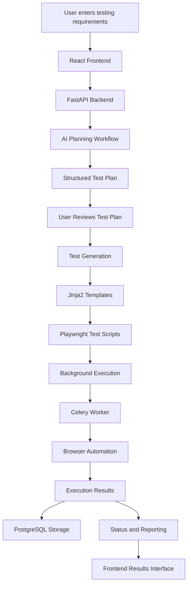

<div align="center">

# 🧪 TestSphere

### AI-Powered Automated Web Testing Platform

**Transform natural-language testing requirements into structured test plans and automated browser tests.**

Build smarter. Test faster. Ship with confidence.

<br/>


<br/>

**AI Planning • Browser Automation • Background Execution • Test Reporting**

</div>

---

## 📌 Table of Contents

- [Overview](#-overview)
- [The Problem](#-the-problem)
- [Our Solution](#-our-solution)
- [Key Features](#-key-features)
- [How It Works](#-how-it-works)
- [System Architecture](#-system-architecture)
- [Technology Stack](#-technology-stack)
- [Project Structure](#-project-structure)
- [Getting Started](#-getting-started)
- [Environment Configuration](#-environment-configuration)
- [Running the Application](#-running-the-application)
- [Testing Workflow](#-testing-workflow)
- [Example Use Case](#-example-use-case)
- [API Documentation](#-api-documentation)
- [Security Considerations](#-security-considerations)
- [Current Limitations](#-current-limitations)
- [Future Roadmap](#-future-roadmap)
- [Contributing](#-contributing)
- [Author](#-author)
- [License](#-license)

---

## 🚀 Overview

**TestSphere** is an AI-powered web testing platform designed to simplify and automate the software testing process.

Traditional web testing often requires testers to manually identify test scenarios, write automation scripts, configure browser automation tools, execute tests, and interpret failures.

TestSphere aims to streamline this process by allowing users to describe their testing requirements in natural language.

The platform uses AI-assisted test planning and browser automation technologies to turn these requirements into structured test scenarios and executable browser tests.

The goal is to make automated testing more accessible to developers, students, QA engineers, and teams that want to improve their software testing workflows.

### 🎯 Project Vision

> Make reliable automated web testing more accessible by bridging the gap between natural-language requirements and executable browser tests.

### Project Information

| Attribute | Details |
|---|---|
| Project Name | TestSphere |
| Category | AI / Software Testing / Test Automation |
| Application Type | Full-Stack Web Application |
| Frontend | React + Vite |
| Backend | Python + FastAPI |
| AI Orchestration | LangChain / LangGraph |
| Browser Automation | Playwright |
| Background Processing | Celery + Redis |
| Database | PostgreSQL |
| Project Status | MVP development and stabilization |
| Primary Objective | AI-assisted automated web testing |

---

## ❗ The Problem

Software testing is essential for maintaining application quality, but creating and maintaining automated tests can be time-consuming.

Traditional testing workflows introduce several challenges.

### 1. Manual Test Planning

Testers must interpret requirements, identify edge cases, and manually create test scenarios.

### 2. Automation Complexity

Writing browser automation scripts requires familiarity with testing frameworks, selectors, assertions, and asynchronous execution.

### 3. Fragmented Tooling

Test planning, script generation, execution, logging, and reporting often involve separate tools and workflows.

### 4. Difficult Failure Analysis

When an automated test fails, developers need useful error messages, execution logs, and contextual information to identify the problem.

### 5. Repetitive Testing Work

Repeatedly writing similar test cases for forms, authentication flows, navigation, and other common web features consumes development time.

TestSphere aims to address these challenges through an integrated AI-assisted testing workflow.

---

## 💡 Our Solution

TestSphere brings multiple stages of web testing into one platform.

Instead of starting by writing automation code manually, a user can describe what needs to be tested.

For example:

> Test the login page with valid and invalid credentials, verify form validation, confirm successful redirection to the dashboard, and check that unauthenticated users cannot access protected pages.

TestSphere is designed to process this request through the following stages:

1. **Requirement Analysis:** Interpret the user's testing objectives.
2. **AI Test Planning:** Generate structured test scenarios and expected outcomes.
3. **Test Review:** Allow users to inspect the proposed test plan before execution, where supported.
4. **Test Generation:** Generate browser automation scripts using Playwright.
5. **Execution:** Run the generated tests against an authorized target application.
6. **Monitoring:** Track execution status and progress.
7. **Reporting:** Present test outcomes and available diagnostic information.

The objective is to reduce repetitive manual work while retaining human oversight over test execution.

---

## ✨ Key Features

The following describes the intended capabilities of TestSphere. Actual availability depends on the functionality implemented and verified in the current build.

### 🤖 1. AI-Powered Test Planning

Use natural language to describe testing requirements.

The AI planning workflow is designed to convert these requirements into structured test scenarios.

Potential outputs include:

- Test objectives.
- Individual test steps.
- Expected outcomes.
- Positive and negative test cases.
- Validation scenarios.
- Potential edge cases.

**Benefit:** Reduces the effort required to translate requirements into an initial test plan.

### 🧠 2. AI Workflow Orchestration

LangChain and LangGraph support the AI workflow.

They can be used to organize tasks such as:

- Processing testing requirements.
- Generating structured plans.
- Coordinating multiple stages of a workflow.
- Validating intermediate outputs.
- Preparing test-generation inputs.

The precise workflow depends on the implementation in the current repository.

### 🧩 3. Automated Test Generation

TestSphere is designed to convert approved test scenarios into browser automation scripts.

The architecture uses:

- **Jinja2** for template-based test generation.
- **Playwright** for browser automation.
- **Python** for backend orchestration.

This approach aims to generate repeatable tests without requiring users to manually write every browser interaction.

Generated scripts should be reviewed and validated before execution, especially when they interact with external applications.

### 🌐 4. Browser Automation

Playwright provides browser automation capabilities.

Depending on the generated test and configured browser environment, automation can perform actions such as:

- Navigating to a webpage.
- Locating page elements.
- Filling input fields.
- Clicking buttons.
- Submitting forms.
- Verifying visible content.
- Checking navigation behavior.
- Evaluating assertions.

### ⚡ 5. Asynchronous Test Execution

Automated browser tests may take longer than ordinary API requests.

TestSphere's architecture uses Celery and Redis to support background task processing.

This design allows longer-running test execution to be separated from the request-response lifecycle of the API.

When configured, the system can use background workers to process test jobs and report their outcomes.

### 📡 6. Execution Status Updates

The architecture includes WebSocket-based communication for real-time status updates.

This can support a more responsive interface by allowing execution progress to be communicated without repeatedly polling the backend.

The actual behavior depends on the WebSocket implementation and frontend integration.

### 📊 7. Test Results and Reporting

TestSphere is designed to collect and present execution results.

Useful reporting information can include:

- Overall execution status.
- Individual test outcomes.
- Failure messages.
- Execution logs.
- Screenshots, when captured.
- Other diagnostic artifacts produced during execution.

The availability of individual report types depends on the implemented execution and reporting pipeline.

### 🗄️ 8. Persistent Storage

PostgreSQL is part of the intended architecture for structured application data.

Depending on the implemented database models, persistent storage can support test plans, execution records, and test results.

### 🐳 9. Containerized Infrastructure

Docker and Docker Compose can be used to simplify the local setup of infrastructure services such as PostgreSQL and Redis.

This helps reduce differences between development environments.

---

## 🔄 How It Works

TestSphere follows a multi-stage testing pipeline.



*This diagram represents the intended end-to-end architecture. Not every stage has been independently verified in the current build.*

### Step 1: Requirement Submission

The user describes the desired testing behavior through the frontend.

The frontend sends the request to the FastAPI backend.

### Step 2: AI-Based Planning

The backend passes the requirements into the configured AI workflow.

The planning stage produces structured test scenarios for the requested functionality.

### Step 3: Plan Review

The generated test plan is presented for inspection.

Where approval controls are implemented, the user can review the plan before authorizing execution.

### Step 4: Script Generation

The test-generation stage converts approved scenarios into Playwright-compatible Python scripts.

Jinja2 templates can provide a consistent structure for the generated scripts.

### Step 5: Background Execution

When background processing is configured, a test job can be submitted for execution by a Celery worker using Redis as its message broker.

The worker runs the browser automation against the specified target.

### Step 6: Result Collection

The execution pipeline collects the available outcomes and diagnostic information.

PostgreSQL can store structured results when persistence is configured.

### Step 7: Reporting

The frontend presents the available status updates and final test outcomes to the user.

---

## 🏗️ System Architecture

TestSphere uses a modular architecture intended to separate presentation, API processing, AI orchestration, browser automation, and infrastructure services.

| Layer | Technology | Responsibility |
|---|---|---|
| Presentation | React | User interface and interactions |
| Frontend Tooling | Vite | Development server and production builds |
| API Layer | FastAPI | HTTP endpoints and backend coordination |
| AI Integration | LangChain | LLM integration and workflow components |
| Workflow Orchestration | LangGraph | Coordination of AI workflow stages |
| AI Model | Gemini, when configured | Natural-language understanding and generation |
| Template Engine | Jinja2 | Structured test-script generation |
| Browser Automation | Playwright | Browser interactions and assertions |
| Background Tasks | Celery | Asynchronous job execution |
| Message Broker | Redis | Background task messaging |
| Database | PostgreSQL | Structured persistent storage |
| Live Communication | WebSockets | Execution status communication |
| Containerization | Docker Compose | Local infrastructure orchestration |

### Architectural Design Goals

**Separation of concerns:** Keep frontend presentation, backend logic, and execution infrastructure distinct.

**Asynchronous execution:** Avoid tying long-running browser tests to the lifetime of a single HTTP request.

**Modularity:** Allow individual components to be developed and improved independently.

**Observability:** Make execution states, failures, and available diagnostic information accessible to users.

**Extensibility:** Create a foundation for adding new testing capabilities and integrations.

---

## 🛠️ Technology Stack

### Frontend

| Technology | Purpose |
|---|---|
| React | Component-based user interface |
| Vite | Frontend development and build tooling |
| JavaScript / JSX | Frontend application logic |

### Backend

| Technology | Purpose |
|---|---|
| Python | Backend programming language |
| FastAPI | API development |
| Uvicorn | ASGI application server |
| LangChain | AI model and application integration |
| LangGraph | AI workflow orchestration |
| Jinja2 | Template-based script generation |

### Automation and Infrastructure

| Technology | Purpose |
|---|---|
| Playwright | Browser automation |
| Celery | Background task processing |
| Redis | Task broker and supporting infrastructure |
| PostgreSQL | Relational database |
| Docker | Containerization |
| Docker Compose | Multi-service local environment |

### External AI Integration

The AI planning workflow can use a configured language model provider, such as Google Gemini.

Provider credentials should be supplied through environment variables rather than committed to source control.

---

## 📁 Project Structure

The following illustrates the expected high-level organization. The exact files and subdirectories may differ from the current repository.

```text
TestSphere/
│
├── backend/
│   ├── app/
│   │   └── main.py
│   │
│   ├── venv/
│   ├── requirements.txt
│   └── ...
│
├── frontend/
│   ├── src/
│   ├── public/
│   ├── package.json
│   ├── package-lock.json
│   ├── vite.config.js
│   └── ...
│
├── docker-compose.yml
├── Start_TestSphere.bat
├── .gitignore
└── README.md
```

### Directory Responsibilities

**`backend/`**

Contains the Python backend, API implementation, and related dependencies.

**`backend/app/`**

Contains the FastAPI application entry point and potentially other backend modules.

**`frontend/`**

Contains the React application, frontend assets, and Vite configuration.

**`docker-compose.yml`**

When present, defines the infrastructure services used by the local environment.

**`Start_TestSphere.bat`**

Provides a convenient Windows launcher for starting the backend and frontend development servers.

**`README.md`**

Documents the project, setup process, architecture, and usage.

> The directory tree above is illustrative. Verify the repository before assuming that every optional file or module exists.

---

## 🚀 Getting Started

Follow these instructions to run TestSphere locally.

### Prerequisites

Install the following software before starting:

- [Git](https://git-scm.com/)
- [Python](https://www.python.org/downloads/)
- [Node.js and npm](https://nodejs.org/)
- [Docker Desktop](https://www.docker.com/products/docker-desktop/), if required by your configuration.

You may also need:

- A configured AI provider API key.
- PostgreSQL.
- Redis.
- A Playwright-compatible browser environment.

The exact requirements depend on which features you want to run.

### 1. Clone the Repository

```bash
git clone <YOUR_GITHUB_REPOSITORY_URL>
```

Navigate into the project:

```bash
cd TestSphere
```

Replace the placeholder with your actual GitHub repository URL.

### 2. Set Up the Backend

Navigate to the backend directory:

```bash
cd backend
```

Create a Python virtual environment:

```bash
python -m venv venv
```

Activate it on Windows PowerShell:

```powershell
.\venv\Scripts\Activate.ps1
```

Install backend dependencies:

```bash
pip install -r requirements.txt
```

If the repository uses a different dependency file, follow its actual configuration.

### 3. Configure Environment Variables

Create the required environment configuration for the backend.

For example, an application might require settings for:

- AI provider credentials.
- Database connection.
- Redis connection.
- CORS origins.
- Application secrets.

Use the actual environment variable names expected by the code.

**Do not commit API keys, passwords, or production secrets to GitHub.**

### 4. Start the Backend

From the `backend/` directory, run:

```powershell
python -m uvicorn app.main:app --reload --host 127.0.0.1 --port 8000
```

If startup succeeds, the API will be available at:

```text
http://localhost:8000
```

Interactive API documentation is available at:

```text
http://localhost:8000/docs
```

### 5. Set Up the Frontend

Open a second terminal and navigate to the project root:

```powershell
cd "$HOME\Desktop\TestSphere\frontend"
```

Install frontend dependencies:

```bash
npm install
```

Start the development server:

```bash
npm run dev
```

Vite normally serves the frontend at:

```text
http://localhost:5173
```

If that port is occupied, Vite may select another port and display it in the terminal.

### 6. Start Infrastructure Services

If the repository contains a working Docker Compose configuration for PostgreSQL and Redis, start those services from the project root:

```bash
docker compose up -d
```

Confirm that the services started successfully:

```bash
docker compose ps
```

This command does not automatically start a Celery worker unless the Compose configuration defines one.

### 7. Start the Background Worker

If the project requires Celery for test execution, activate the backend virtual environment and start the worker using the Celery application path defined in the repository.

For example, a project configured with `app.celery_app` might use:

```powershell
python -m celery -A app.celery_app worker --loglevel=info --pool=solo
```

This is an example, not a guaranteed command for the current repository. The Celery application path and worker configuration must match the actual implementation.

On Windows, `--pool=solo` can be useful for local development, but production workers should be configured according to the deployment environment.

---

## ⚡ Running TestSphere with One Click on Windows

TestSphere includes a Windows batch launcher named `Start_TestSphere.bat`.

When configured correctly, it can start the backend and frontend in separate terminal windows and open the application in the browser.

### Usage

1. Navigate to the project root.
2. Double-click `Start_TestSphere.bat`.
3. Wait for the frontend and backend servers to start.
4. Open the application at `http://localhost:5173`.

### Important Notes

- Keep the server terminal windows open while using the application.
- Start Docker services separately if the launcher does not start them.
- Start the Celery worker separately if background execution requires it.
- Closing the browser tab does not automatically stop the servers.

---

## 🧪 Testing Workflow

TestSphere is intended to support an AI-assisted testing process.

### Example: Testing a Login Page

Suppose the target application contains a login page.

A user might submit the following requirements:

```text
Test the login page.

1. Verify that the login form loads.
2. Check validation for empty fields.
3. Verify rejection of invalid credentials.
4. Verify successful login with valid credentials.
5. Check redirection after successful authentication.
6. Verify that unauthenticated users cannot access
   protected pages.
7. Report failed assertions and execution errors.
```

The intended workflow is:

1. Submit the requirements.
2. Generate a structured test plan.
3. Review the generated test scenarios.
4. Approve the plan where approval controls are implemented.
5. Generate the browser automation scripts.
6. Execute the tests against an authorized target.
7. Inspect the outcomes and diagnostic information.

### Example Test Scenarios

| Scenario | Expected Outcome |
|---|---|
| Login page loads | Page renders successfully |
| Empty credentials | Validation is displayed |
| Invalid credentials | Authentication is rejected |
| Valid credentials | Login succeeds |
| Protected page without authentication | Access is restricted |
| Failed assertion | Test is marked as failed |
| Unreachable target | Execution reports an error |

These are example acceptance criteria for a login-testing workflow. They are not a claim that every scenario is already implemented or passing.

---

## 📚 API Documentation

TestSphere uses FastAPI for its backend.

When the backend is running locally, visit:

**Swagger UI:** `http://localhost:8000/docs`

**ReDoc:** `http://localhost:8000/redoc`

These interfaces display the API routes and request schemas exposed by the running application.

The available endpoints depend on the current backend implementation.

Potential API responsibilities include:

- Receiving testing requirements.
- Generating test plans.
- Submitting test executions.
- Retrieving execution status.
- Returning test results.
- Supporting live execution updates.

Refer to the generated API documentation for the actual endpoints available in your build.

---

## 🔐 Security Considerations

Automated testing systems can interact with websites and execute generated code, so security must be considered from the beginning.

### Protect Credentials

- Store API keys and database credentials in environment variables or a secret manager.
- Never commit `.env` files containing real credentials.
- Avoid exposing private credentials in logs or browser responses.

### Restrict Target Applications

- Run tests only against applications you own or are authorized to test.
- Validate target URLs.
- Consider blocking access to private network addresses and cloud metadata endpoints.
- Apply appropriate network isolation to browser workers.

### Review Generated Scripts

AI-generated code should not be treated as inherently safe.

- Review generated scripts before execution.
- Avoid running untrusted code with unrestricted operating-system permissions.
- Isolate browser execution from sensitive host resources.
- Restrict destructive operations unless explicitly authorized.

### Protect the API

A public deployment should include appropriate authentication, authorization, rate limiting, input validation, and execution limits.

### Manage Test Data

Use dedicated test accounts and non-production data whenever possible.

These are recommended security practices; their implementation must be verified in the deployed application.

---

## ⚠️ Current Limitations

TestSphere is an evolving MVP.

The following areas should be validated before the application is treated as production-ready.

### AI Planning Quality

Generated test plans may require human review to ensure that they match the intended requirements.

### Generated Code Reliability

Generated Playwright scripts may require adjustments when target applications have unusual layouts, dynamic content, authentication requirements, or unstable selectors.

### Browser Execution Environment

Browser automation requires compatible browsers and operating-system dependencies.

### Background Processing

Celery execution depends on the correct worker configuration, a reachable Redis broker, and working task definitions.

### Real-Time Updates

WebSocket status reporting depends on correct backend and frontend integration.

### Persistence

Reliable result history depends on the configured database, models, and persistence workflow.

### Deployment

Local development success does not guarantee that the same application will work in a cloud environment.

Production deployment requires appropriate configuration for environment variables, database connectivity, CORS, browser dependencies, worker processes, and network access.

**The MVP should be evaluated against actual execution results rather than the presence of individual components in the architecture.**

---

## 🗺️ Future Roadmap

The following roadmap outlines potential improvements.

These are proposed development goals, not claims that the features already exist.

### Phase 1 — Core Stability

- [ ] Stabilize the complete requirement-to-execution workflow.
- [ ] Improve test-plan validation.
- [ ] Validate generated Playwright scripts.
- [ ] Improve execution error handling.
- [ ] Ensure failed tests are reported accurately.
- [ ] Verify persistence of test results.

### Phase 2 — Better Reporting

- [ ] Add detailed execution summaries.
- [ ] Improve failure diagnostics.
- [ ] Integrate screenshots into reports.
- [ ] Add execution duration metrics.
- [ ] Improve access to execution logs.

### Phase 3 — Testing Capabilities

- [ ] Expand support for complex web interactions.
- [ ] Improve handling of dynamic page elements.
- [ ] Add reusable test scenarios.
- [ ] Improve support for authenticated applications.
- [ ] Introduce regression-testing workflows.

### Phase 4 — Reliability and Security

- [ ] Improve isolation of browser workers.
- [ ] Add execution timeouts and resource limits.
- [ ] Strengthen API authentication and authorization.
- [ ] Improve target URL validation.
- [ ] Add structured monitoring and diagnostics.

### Phase 5 — Deployment and Scalability

- [ ] Deploy the frontend and backend.
- [ ] Configure hosted PostgreSQL and Redis.
- [ ] Deploy background workers.
- [ ] Validate Playwright execution in the hosting environment.
- [ ] Add continuous integration and automated regression checks.
- [ ] Improve deployment documentation.

---

## 🤝 Contributing

Contributions, bug reports, and suggestions can help improve TestSphere.

### How to Contribute

1. Fork the repository.
2. Create a feature branch.
3. Make your changes.
4. Test your changes locally.
5. Commit your work.
6. Open a pull request describing the changes.

Example:

```bash
git checkout -b feature/your-feature-name
```

After making and testing your changes:

```bash
git add .
git commit -m "Add: describe your changes"
git push origin feature/your-feature-name
```

When contributing, please:

- Keep changes focused.
- Avoid committing credentials or generated secrets.
- Include reproduction steps for bug reports.
- Document configuration changes.
- Test relevant functionality before submitting a pull request.

---

## 👨‍💻 Author

**Shrijesh Kumar**

Computer Science Engineering — Artificial Intelligence and Machine Learning

TestSphere is a project focused on exploring the intersection of AI, full-stack development, and automated software testing.

The project brings together AI workflow orchestration, API development, browser automation, background processing, and database-backed application architecture.

---

## 📄 License

A license has not yet been specified in this README.

Before publishing the repository for reuse, choose an appropriate license and add a `LICENSE` file to the repository.

Until then, do not assume that the code is available for unrestricted reuse, redistribution, or commercial use.

---

<div align="center">

### TestSphere

**From natural-language requirements to automated testing.**

*Build smarter. Test faster. Ship with confidence.*

</div>
